# RC-LocalLiveTranslate

**Android 本地同传 · 中英日韩粤自动识别接入 · 会话内说话人追踪 · 双向翻译字幕**

[下载最新版 0.3.3](https://github.com/JDui/RC-LocalLiveTranslate/releases/tag/v0.3.3) · Android 9+ / ARM64 · **正式版 · 公开 APK 携带四模型（686.3 MiB）**。

识别、翻译和声纹追踪全部在手机本地运行，不上传录音、字幕或诊断。公开整合版首次启动自动安装内置的四个模型，可完全离线准备。无模型版本可在「设置 → 离线模型」主动下载缺失模型或通过本地 ZIP 导入；模型准备后可断网使用。无账号、遥测或云推理；除主动下载权重外，主动「获取当地城市」使用手机系统定位 / 地理编码，系统服务可能联网，语音推理不依赖它。当前发行号为正式版 0.3.3；真实 ARM 手机音频链路、准确率及长期性能仍待验收。

0.3.3 加入默认衬线字体及持久化开关，统一按钮圆角、嵌套留白和大字体布局，补齐空态、危险操作及禁用说明。主导航为字幕 / 记录 / 设置，离线模型和运行诊断移入设置子页；Dock 跨页面保持固定，展开屏的设置入口固定在侧栏底部。声纹首次尝试不再等待整句识别完成，说话人使用稳定独立配色；记录支持首次左滑展开、再次左滑删除。应用显示名为「RC翻译魔芋」，保留牛皮纸主题、中 / 英 / 日 / 韩 / 粤双向选择和本地模型。0.8 秒为声纹首次尝试的音频门槛，实际延迟及五语真人质量仍待真机验证。

## 实际界面

下图来自本版 0.3.3 签名整合 Release APK 的 Android API 35 模拟器。系统字体100%，保留完整画面、原始像素，无裁切或图像缩放。竖屏1080×2520（21:9、480dpi）；接近方形的展开屏1800×1920（320dpi）。展开尺寸展示侧栏/双栏适配，不代表真实铰链或OEM开合测试。字幕和记录为明确标记的固定演示，不是实际识别结果；4/4 模型是本版内置模型经生产导入器安装后的文件状态，不是推理结果。点击图片可查看原图。

| 21:9 1080P竖屏 | 接近方形的折叠展开屏 |
| --- | --- |
| 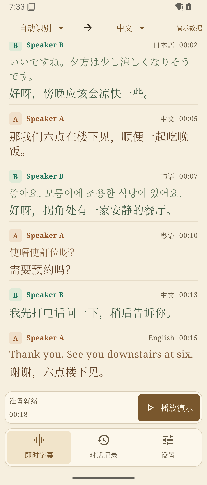 | 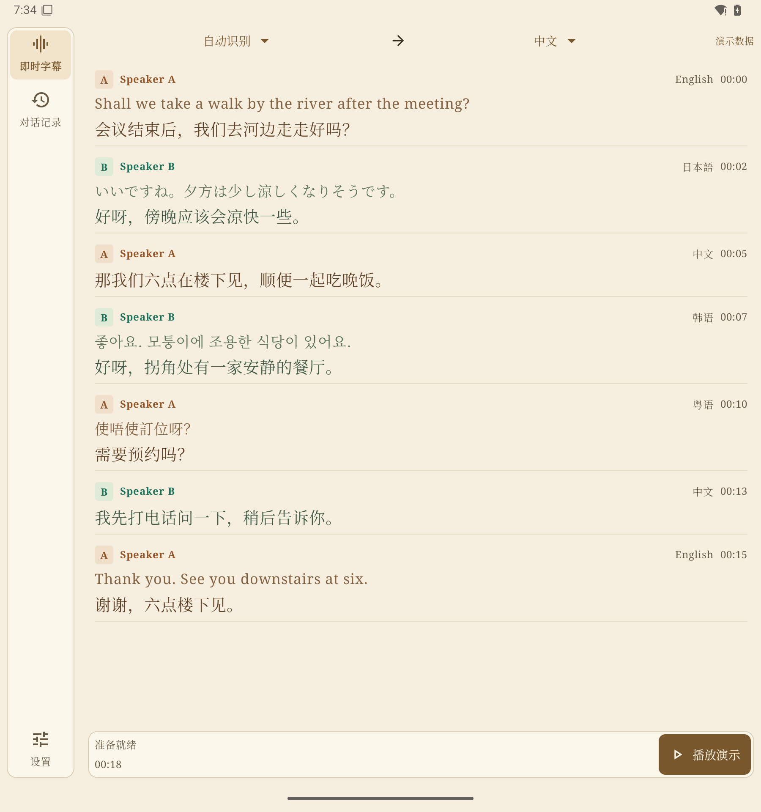 |
| 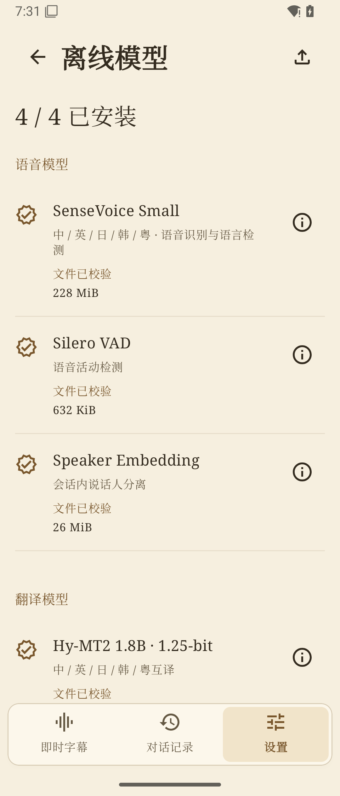 | 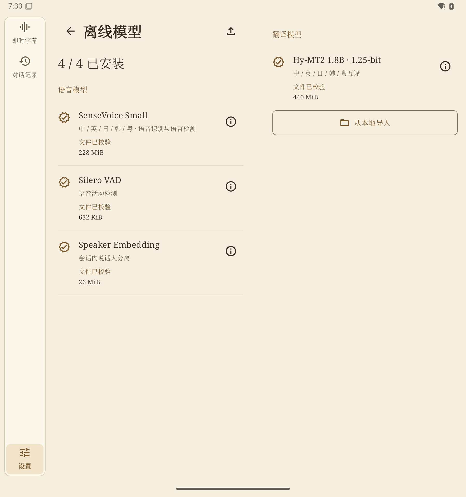 |
| 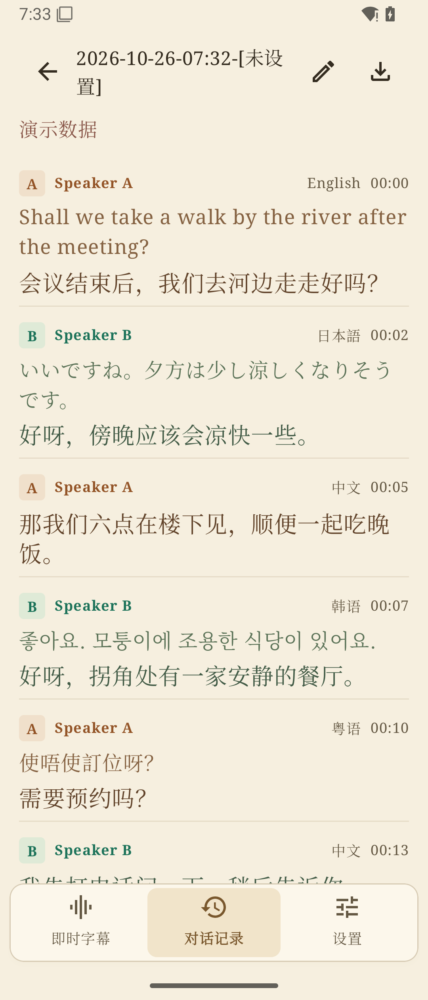 | 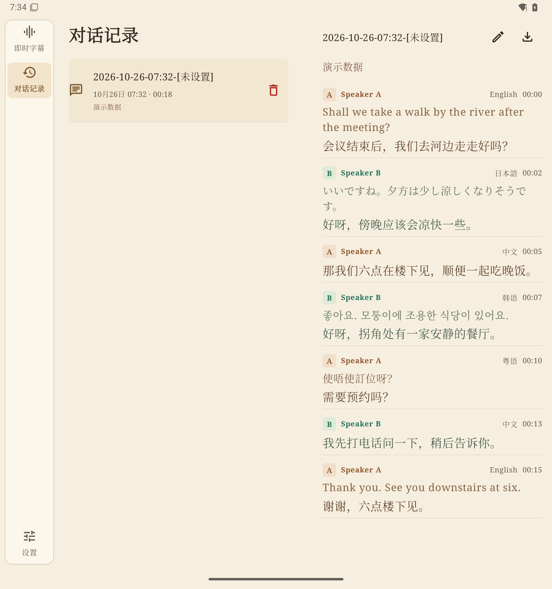 |
| 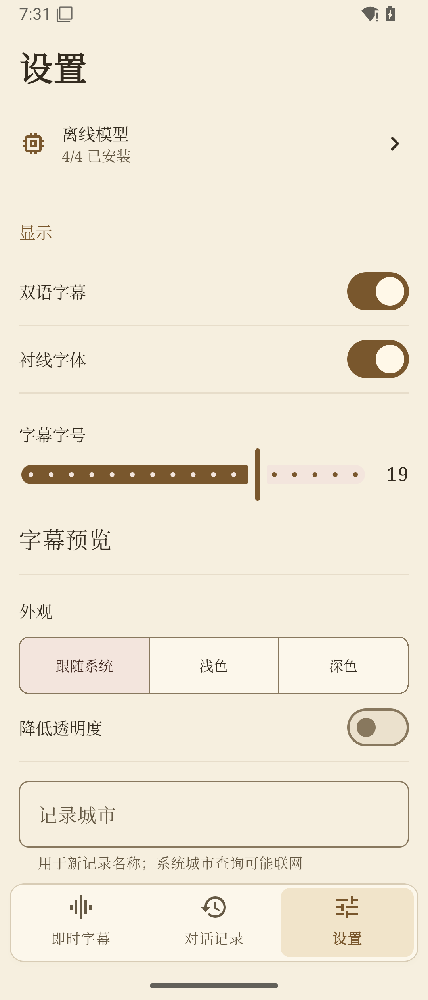 | 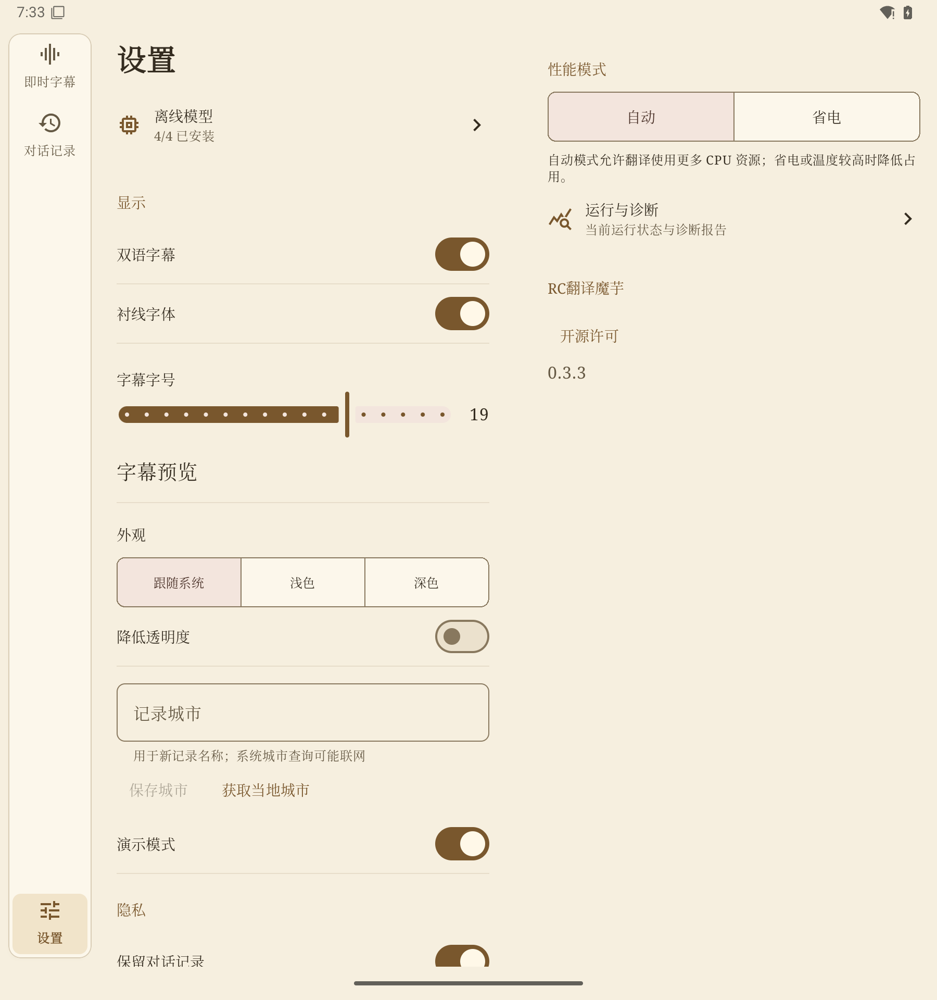 |
| 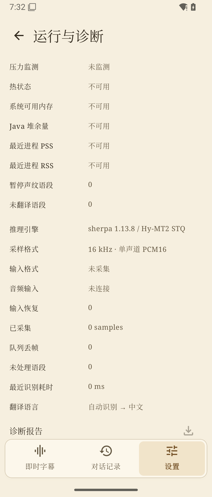 | 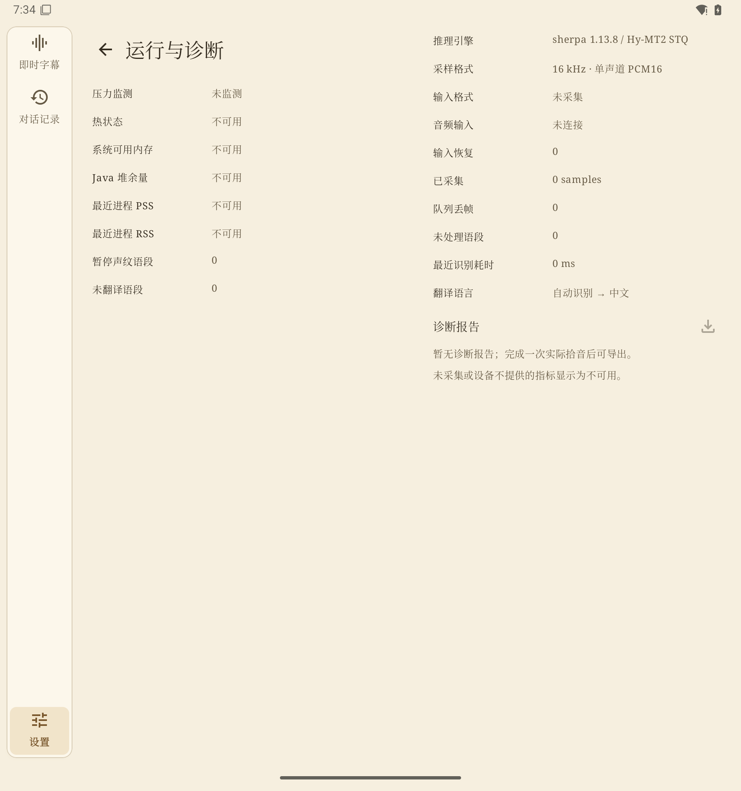 |

## 安装和模型准备

1. 下载Release中的 `RC-LocalLiveTranslate-0.3.3-arm64-bundled.apk` 并安装；沿用已有签名，可覆盖以前的公开版本。
2. 首次启动等待内置的 SenseVoice、Silero VAD、CAM++、Hy-MT2 四模型安装和校验完成，离线模型页显示 4/4。完整原始权重约697 MiB，至少预留2 GiB可用空间；已有模型保留。
3. 维护者也会构建无模型 APK；该版本可主动下载缺失模型（有进度、取消与重试，无后台续传），或在电脑用 `scripts/prepare-speech-models.ps1` 和 `scripts/prepare-hymt-model.ps1` 生成离线ZIP，经SAF导入。所有路径、固定大小、SHA、版本和许可证均在安装前校验。
4. 四模型就绪后，在两个语言框中选择自动识别及目标语言，或两种不同语言进行双向互译；授权麦克风，从可见字幕页开始。演示开关位于设置，可在无模型时查看固定示例。
5. 记录可关闭、回看、重命名、删除，并导出TXT/SRT/JSON；不保存原始音频。

公开整合版内置四模型；下图另取自本版无模型 APK 的全新安装状态，用于展示可选的一键下载入口：

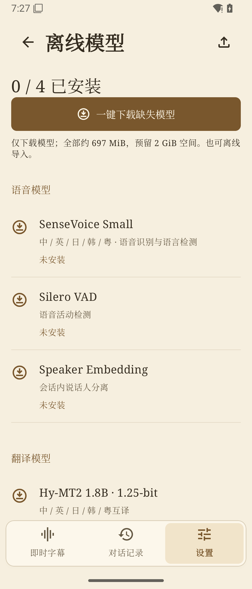

| 本地模型 | 用途 | 权重许可 |
| --- | --- | --- |
| SenseVoice Small INT8（2024） | 中英日韩粤ASR与语言检测接入 | FunASR Model License 1.1 |
| Silero VAD | 语音活动检测 | MIT |
| CAM++ | 会话内说话人向量 | Apache-2.0 |
| 腾讯Hy-MT2 1.8B STQ1_0 | 中英日韩粤翻译接入 | Apache-2.0 |

来源、版本、固定摘要和许可全文随下载清单保留；权重许可不等同于推理引擎或本项目许可证。旧Foxlet/M2M100包不用于当前翻译。

## 当前实现和边界

Kotlin + Compose + Material 3；AudioRecord采集与推理/UI隔离；sherpa-onnx 1.13.8执行本地VAD/ASR/LID/embedding，Hy-MT2由固定llama.cpp STQ CPU/JNI执行。支持紧凑字幕、8–24 sp字号、浅深主题、记录时间/城市命名、展开双栏和铰链安全区、有界字幕窗口和分段数据库存储。

0.3.3 的构建、测试、两种制品及本版模拟器截图证据见[验证文档](docs/11_VALIDATION.md)。**没有真实ARM手机同传、CER/WER、译文质量、跨语种同人身份、长时间热机/电池或性能结论。**Speaker A/B是会话内聚类标签，不是身份识别；SenseVoice按语段推理，译文有延迟。城市查询只保存城市名，失败可手动填写；系统服务可能将坐标发送至设备服务商，详见[城市查询说明](docs/adr/0008-device-city-lookup.md)。

STQ内核来自固定未合并PR，属于实验依赖。项目自身LICENSE尚未选定；原生、模型和传递依赖条款分别保留，不宣称完整商用合规。

## 构建和文档

```powershell
./scripts/build.ps1 -Tasks @('assembleRelease', 'testDebugUnitTest', 'lintRelease', 'assembleDebugAndroidTest', '--no-daemon', '--max-workers=2')
./scripts/package-release.ps1 -Version 0.3.3
# 使用已准备的四模型 ZIP 构建本次公开整合版
./scripts/build-bundled.ps1 -Version 0.3.3
```

普通构建不内置权重；本次公开附件通过 build-bundled.ps1 构建并携带四模型。两个版本均保留在本地 .tools/releases/。模型、签名材料和本地APK放在忽略目录，不提交Git。

- [最新版发行说明](docs/28_RELEASE_0_3_3.md) · [验证证据和待测项](docs/11_VALIDATION.md)
- [开发准备和包协议](docs/10_DEVELOPMENT.md) · [模型来源与准备](docs/14_MODEL_PREPARATION.md)
- [隐私/权限/许可矩阵](docs/09_COMPLIANCE.md) · [用户主动下载ADR](docs/adr/0007-user-initiated-model-downloads.md)
- [GUI规格](docs/06_GUI.md) · [折叠适配验收](docs/13_ADAPTIVE_ACCEPTANCE.md) · [真机基准工具](docs/17_BENCHMARK.md)
- [有界字幕与分段存储](docs/22_EFFICIENCY_MAINTENANCE.md) · [翻译速度规划](docs/21_TRANSLATION_SPEED_PLAN.md)
- [产品范围](docs/01_REQUIREMENTS.md) · [技术栈](docs/02_STACK.md) · [架构](docs/03_ARCHITECTURE.md) · [音频与说话人](docs/04_AUDIO_AND_SPEAKERS.md) · [翻译路由](docs/05_MODELS_AND_TRANSLATION.md)
- [质量门禁](docs/07_QUALITY.md) · [路线](docs/08_ROADMAP.md) · [图标](docs/12_ICON.md) · [可选本地整合构建](docs/19_BUNDLED_LOCAL.md) · [贡献规则](AGENTS.md)

上游：[sherpa-onnx](https://github.com/k2-fsa/sherpa-onnx) · [SenseVoice](https://github.com/FunAudioLLM/SenseVoice) · [Hy-MT2](https://huggingface.co/tencent/Hy-MT2-1.8B-1.25Bit-GGUF) · [Compose](https://developer.android.com/develop/ui/compose)。
