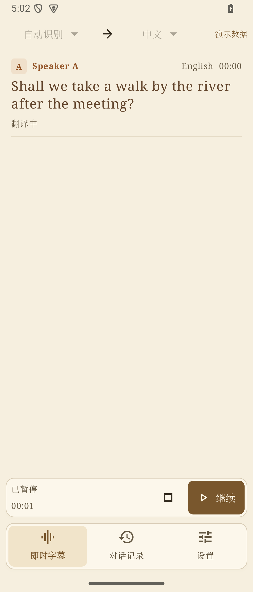
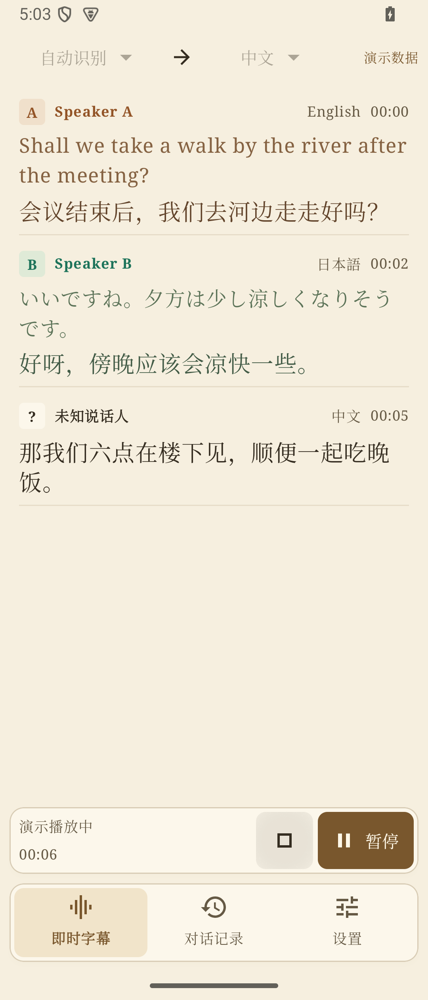
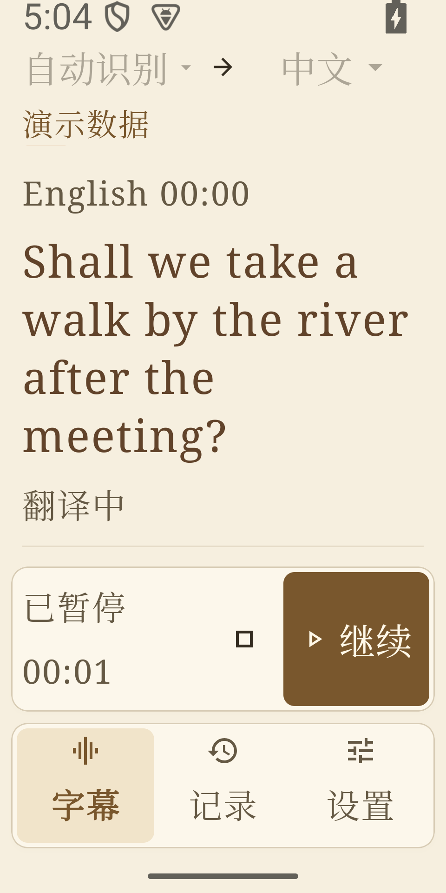

# UI 全流程审查台账 — 2026-10-26

依据：所有者提供的九张检查表。前八类共 94 项；第九类作为验收门禁。保留现有浅奶油 / 暖棕主题、小圆角、默认衬线字体、三项导航和完全本地推理。

## 执行和评分规则

主线程逐环节检查 → Luna Max 独立首轮复审 → 主线程修改 → Luna Max 修改后复审评分。任一轮存在已知缺陷或证据不足，不能为了达到目标而填写满分。整改后继续复审，只有连续两轮均为 10/10 的环节才通过。代码审查、主机渲染、模拟器操作、真机验收分别记录；不把前三者称作真机或真实模型验收。P0/P1 未关闭不可通过，P2 记录影响和安排，不作为遗漏其他问题的理由。

所有者进一步要求评分苛刻：逐项核对，不凭整体观感给高分；未验证的适用项必须扣分，P2 视觉瑕疵同样阻止满分。不能取平均分掩盖单项缺陷，也不能因为缺少设备而把存在的功能改成“不适用”。前两轮分数保留原始记录，后续按此更严格标准复评。

初始工作区已有七个修改文件：AppData.kt、GlassTheme.kt、TranslateApp.kt、ComposeUiTest.kt、LocalDataTest.kt、06_GUI.md、11_VALIDATION.md。本轮在其基础上工作，不回退已有改动，不提交或推送。

## 环节和检查项分配

G1–G7 是本项目的实际环节；同一个公共检查项可在多个环节复用。标为“待验证”的功能存在，只是缺少证据，不能当作不适用删除。

| 环节 | 页面与状态 | 分配的检查项 |
| --- | --- | --- |
| G1 全局框架 | 底部导航 / 侧栏；浅深主题；320/360/412 dp 手机、横屏、平板、200% 字体、book/tabletop 铰链 | L-01–08、L-10–12；B-01–12、B-14；T-01–07、T-09–14；W-07、W-09；V-01–09；R-01–05、R-07–10 |
| G2 即时字幕 | 自动→中文与双语菜单；空 / 演示 / 拾音 / 暂停 / 启停中；字幕修订与失败；压力提示；权限拒绝；跟随最新 | L-01–08、L-10–12；B-01–12、B-14；T-01–07、T-09–14；C-06、C-08、C-12–13；W-07、W-09；S-01–06、S-08、S-10–12；V-01–09；R-01–10 |
| G3 对话记录 | 空列表、分页、选中、详情、长标题、重命名、导出格式、SAF、两次独立左滑与删除确认 | L-01–08、L-10–12；B-01–14；T-01–14；C-01–05、C-08–09、C-12–13；W-03–07、W-09；S-01–08、S-10–12；V-01–09；R-01–10 |
| G4 设置 | 字体、字号、主题、透明度、城市输入与系统定位、演示开关、保留记录、自动 / 省电、返回恢复 | L-01–08、L-10–12；B-01–12、B-14；T-01–14；C-01–07；W-07、W-09；S-01–06、S-08–12；V-01–09；R-01–10 |
| G5 离线模型 | 未安装 / 已校验 / 占用；下载与取消 / 失败 / 重试；离线导入；详情 / 许可来源 / 删除 | L-01–08、L-10–12；B-01–14；T-01–14；C-08–09；W-03–07、W-09；S-01–12；V-01–09；R-01–10 |
| G6 运行与诊断 | 未监测 / 运行；热状态和内存；长设备名；无报告 / 可导出；JSON / CSV 与 SAF | L-01–08、L-10–12；B-01–12、B-14；T-01–14；W-03–07、W-09；S-01–04、S-06、S-08、S-10–12；V-01–09；R-01–10 |
| G7 弹窗与许可 | 模型详情 / 删除、会话重命名 / 删除、导出格式、许可列表与正文；小窗口 / 键盘 / 铰链 | L-01–08、L-10–12；B-01–14；T-01–14；C-01–05、C-08、C-12–13；W-03–07、W-09；S-01–04、S-06–07、S-10–12；V-01–09；R-01–03、R-05–06、R-08–10 |

## 明确不适用或条件适用

| 检查项 | 本项目处理 |
| --- | --- |
| L-09 卡片对齐；W-01 卡片内部布局；W-02 卡片高度 | 没有卡片网格；字幕是无框列表，不增设卡片。现有导航 / 录音面板的内边距与边界仍按 L-07、L-12 检查。 |
| C-10 表格列对齐；C-11 表格密度 | 没有数据表格。诊断采用标签 / 数值行，改按 T-07、T-11、L-03 检查。 |
| W-08 浮动工具栏 | 没有可拖拽悬浮工具栏；底部固定录音区按 W-09 / L-12 检查。 |
| W-10 多屏幕 | 不支持桌面多显示器窗口管理。Android 多窗口 / 分屏 / 外屏 / 折叠姿态仍按 R-01、R-02、W-09 检查，OEM 真机待验收。 |
| B-10、B-12、V-05 悬停 / Tooltip | 触摸和长按适用；鼠标悬停、物理键盘焦点需有对应输入证据，不能仅凭截图认定通过。 |
| S-09 网络异常 | 只适用于用户主动下载模型、系统城市查询；离线字幕与本地历史不增加联网流程。 |
| R-08 占位内容 | 用户显式开启的演示模式保留“演示数据”标识，不作为未清理的调试占位；无音频 / 真实权重证据时不将演示称为推理成功。 |
| S-07 撤销 | 两次独立左滑属于既有防误触设计，保留；删除按钮需确认。无需新增回收站或假称可恢复。 |

## 本轮证据目录

- `.tools/ui-audit/before/`：本轮初始 Compose 渲染截图，2026-10-26 首次运行生成；包含手机、横屏、平板、200% 字体、book / tabletop、分页与导出弹窗。
- `.tools/ui-audit/after/`：修改后的同条件截图和模拟器操作记录。
- `.tools/ui-audit-baseline.log`：初始 ComposeUiTest 构建与执行记录。
- 旧的 `.tools/emulator-validation/`、`.tools/prealpha6-screenshots/` 不作为本轮截图验收证据。
- `before/emulator-start.png` 捕获到启动画面，已拒收，不能用于当前页面验收；当时模拟器安装包早于当前源码。

## 首轮主线程发现

1. 危险确认与普通按钮同色，模型删除提示没有说明不可恢复和重新导入路径（B-09、B-13）。
2. 演示开关只有开关本体可点击，和其他整行开关不一致；城市操作在放大字体下缺少换行安排（B-03、C-07、T-14）。
3. 字号滑块缺少明确可访问名称；诊断导出禁用没有可见原因（B-11、B-14）。
4. 页标题、会话长标题、诊断值和窄屏菜单需要针对性验证；不以固定短文案截图替代（T-09–10、T-14、R-06）。
5. 非折叠普通弹窗没有公共的内容滚动保护，长删除文案需要覆盖小屏 / 大字体（W-04、W-09）。
6. 字号、图标和分组间距存在局部 3/6/10/14/18 dp 随意取值，需统一公共令牌而保持字幕密度（L-06、V-02）。

## 逐轮记录

| 环节 | Luna 首轮 | 修改后复审 | 第三轮严格复评 | 结论 |
| --- | --- | --- | --- | --- |
| G1 | 7.5/10 | 9.5/10 | 8.5/10 | 未通过 |
| G2 | 7.5/10 | 9/10 | 7/10 | 未通过 |
| G3 | 7/10 | 10/10 | 8.5/10 | 撤回宽松满分，未通过 |
| G4 | 7/10 | 9.5/10 | 8.5/10 | 未通过 |
| G5 | 6/10 | 8.5/10 | 7.5/10 | 未通过 |
| G6 | 7/10 | 9/10 | 7.5/10 | 未通过 |
| G7 | 6.5/10 | 9/10 | 8.5/10 | 未通过 |

Luna 首轮明确没有环节通过。确认的首轮问题：危险操作配色、演示开关整行点击、城市重复保存与反馈、禁用诊断导出说明、普通弹窗滚动保护；另外模型进度 / 详情 / 删除、会话重命名 / 导出 / 删除和许可列表 / 正文的状态截图缺失。

第二轮确认首轮缺陷关闭；新增 320 dp / 200% 字体下主题按钮高度不齐、说话人名称被拆行、普通弹窗贴边及通用间距残留的整改。通过真实系统文件选择器导入四个已存在的本地模型包，最终显示 4/4；这是文件导入和校验的证据，不是模型推理成功。

第三轮按所有者要求收紧评分，G3 的旧满分不再有效。Luna 未确认新增 P0/P1，扣分主要来自适用状态的验证缺口。主线程没有根据模拟器的 ABI 报错给生产按钮增加永久禁用，也不将尚未复现影响的重试建议写成已确认缺陷。

第三轮后补充实际模拟器操作：`emulator-54`–`57` 为已安装模型详情、删除确认、删除降为 3/4、SAF 重导入回到 4/4；`59` 为真实长按 Tooltip；`60`–`63` 为 TXT / SRT 系统保存成功。三个导出文件已读取：`exported-demo.json`、`exported-demo.txt`、`exported-demo.srt`，均为七条演示字幕，SRT 序号、递增时间区间与字幕内容完整。`64` 证明已有任务回到前台保留会话详情，但 `am kill` 未确认进程确实终止，不能据此称为进程死亡恢复通过。`65`–`68` 覆盖删除确认取消、第一次左滑展开“再滑一次”、右滑收起、两次独立左滑删除并显示空态。`71`–`72` 覆盖手动保存测试城市 Shanghai，`am force-stop` 后 COLD 启动值仍保留，重复保存按钮禁用。`69` 截图实际上是模型子页，不作为城市证据。

### 第四轮严格独立复审

Luna Max 直接检查新增截图、XML、三个导出文件及测试结果；本轮没有确认新的 P0/P1 或可复现视觉缺陷。评分针对完整适用范围，主机 / 模拟器覆盖不足的状态仍扣分，不能把本表解释为界面存在相同比例的已知缺陷。

| 环节 | 第四轮分数 | 健康状况与尚未关闭的验收证据 |
| --- | --- | --- |
| G1 全局框架 | 8.5/10 | 已整改；OEM 折叠 / 真实铰链、多窗口、TalkBack 待验。 |
| G2 即时字幕 | 7.5/10 | 已整改；ARM64 实际拾音、暂停 / 恢复 / 停止、压力反馈待验；不把失败后重试当已确认缺陷。 |
| G3 对话记录 | 9/10 | 导出与删除实际操作已补；历史分页主要为主机 fixture，确切进程死亡恢复与文本选择 / 剪切 / 粘贴待验。 |
| G4 设置 | 9/10 | 手动城市保存及冷启动已补；系统 Geocoder 成功待验。 |
| G5 离线模型 | 8.5/10 | 详情 / 删除 / 重导入 / 长按提示已补；实际持续下载中的取消与重试进度待验。 |
| G6 运行与诊断 | 7/10 | 空态说明已整改；ARM64 运行指标、实际诊断 JSON / CSV 的 SAF 保存和内容待验。 |
| G7 弹窗与许可 | 9/10 | 小屏大字和 IME 已整改；真实铰链与 TalkBack 待验。 |

**结论：七个环节全部保持未通过，没有连续两次 10/10。** 不通过不是取消整改成果，而是明确保留验收门禁；后续补测应复用本表，只对证据变化的项目更新评分，不能要求审查者调整分数来达成满分。

## 本轮构建与检查

### 后续专项：按钮圆角、嵌套边缘与面板留白

所有者追加截图指出“继续”按钮与外框的圆角 / 边缘留白不协调，本专项继续处理实际可见缺陷，不用 ARM64 录音尚未验证来代替视觉检查。原 G1–G7 全流程未通过的结论保留；专项通过不能覆盖它们。

主线程确认：录音条原内距为水平 8、垂直 4 dp；城市操作和滑动删除按钮遗漏显式形状；工具按钮默认反馈与小圆角体系不同。现统一为面板 12 dp / 控件 8 dp / 等距内缩 4 dp，主按钮随行高伸缩；状态文字对齐正文 16 dp 基线。导航选中区使用相同嵌套规则。城市操作、滑动删除与透明工具按钮显式采用 8 dp 形状。

Luna Max 专项首轮：8/10；没有 P0/P1，指出控制条与导航间隔约 4 dp 偏紧，以及必须补当前 APK 和按下反馈截图。此建议作为本轮实际整改，不以旧全流程评分替代。

修后：有框控制面板与导航间隔 8 dp；上方无框字幕间隔 4 dp 保留阅读高度。曾尝试上下外距均 8 dp，触发原有 `compactLiveKeepsMostHeightForSubtitles` 的 450 px 最小阅读高度检查（日志 `.tools/ui-audit-button-reviewed.log`），随后调整布局，未放宽断言。最终 `.tools/ui-audit-button-final2.log` 全量构建成功（1m 37s，220 tests / Compose 59 tests，0 failures / errors），lint 0 errors / 16 warnings，原生门禁 `.tools/ui-audit-button-native.log` 通过。公共 Live 截图矩阵增加实际边界断言：按钮上 / 下 / 右内缩各 4 dp，按钮至少 48 dp，高度自适应；横向导航与控制面板左右同边、间隔 8 dp。

本专项证据目录：`.tools/ui-audit/after/buttons/`；主机矩阵来自最终构建，原生截图来自更新后的独立 HyValidation APK，均非物理设备。`01-paused`、`02-primary-pressed`、`03-playing`、`04-stop-pressed` 分别为暂停、继续按下、播放、停止按钮按下状态。长按工具按钮由 Tooltip 消耗点击，`05-playing-after-hold` 仍在播放，不能称为停止成功；`05-finished` 为演示自动结束。`06-paused-320-font200` 是实际 320 dp / 200% 字体；`08-city-controls` 是完整城市输入区；`09-city-touch-feedback-inconclusive` 未捕获明显反馈，不作为可靠按下证据；`10-city-query-feedback` 为实际查询忙碌。模拟器显示尺寸和字体已恢复原值。

修改后首轮复审时原 `gpt-6-luna / max` 审查器返回使用额度限制，没有产出评分；不能记录成完成或通过。继续由 `gpt-5.6-luna / max` 独立只读复审同一专项，明确记录审查器版本与结果。

`gpt-5.6-luna / max` 修改后第一轮独立复审：**10/10**。查看用户原图、浅深主题、200% 字体、原生主按钮 / 停止按钮按下、320 dp / 200% 字体与城市控件；核对公共形状、按钮调用、几何断言和最终测试日志，未发现阻塞缺陷。城市按下截图不明确仍如实记为 inconclusive，不以空闲态文字按钮没有持续边框判定为缺陷。当前已要求扩大至小屏、横屏、book / tabletop、删除弹窗与滑动删除再做第二轮独立复核；首轮满分不能独自通过。

`gpt-5.6-luna / max` 修改后第二轮独立复核：**10/10**。重新查看原图，并扩查小屏、横屏、book / tabletop、设置、模型 / 会话删除弹窗、滑动删除，再核对浅深主题、200% 字体与原生按下状态。未发现具体可扣分问题；主按钮随行高伸缩，反馈限制在小圆角边界内，公共按钮调用未发现形状遗漏。两轮均未修改代码。**本次圆角 / 嵌套边缘 / 留白专项两轮满分，通过；原 G1–G7 全流程状态保持未通过。** 主线程核对最终 diff、截图与测试后认可这个范围内的结论。

1. 控制条与导航嵌套：4 dp 等距内缩、8 dp 面板间距，专项两轮复审通过。

2. 实际按下反馈：停止工具按钮采用小圆角矩形，专项两轮复审通过。

3. 大字体与同类控件：实际 320 dp / 200% 字体仍保持嵌套关系；城市、滑动删除和其他工具按钮同步检查，专项两轮复审通过。

`.tools/ui-audit-validation-final4.log`：Debug APK、全部主机单元测试、lint、Android 测试 APK、隔离 HyValidation APK 构建成功，1m 38s；220 tests，0 failures / errors，其中 ComposeUiTest 59 tests。lint 0 errors / 16 warnings，保留原生注释、kapt 与版本更新提示。没有放宽已有紧凑字幕高度断言。

`.tools/ui-audit-native-final.log`：必需 JNI、无 TTS、固定 STQ 来源清单与五个 ARM64 ELF / APK ZIP 16 KB 对齐检查全部通过。主机绘制和模拟器运行都不等同于真实 ARM64 音频推理。未运行 connected instrumentation，测试 APK 编译不能称为 instrumentation 已通过。原模拟器应用包和数据未删除，隔离测试包与合成记录仅用于本轮界面验证。

## 实际运行边界

1. 原模拟器的 `com.jd.rc.localtranslate` 与本轮 Debug 签名不同，覆盖安装返回 `INSTALL_FAILED_UPDATE_INCOMPATIBLE`。保留原包与数据，改用项目已有的独立 `.hyvalidation` 包进行界面验证。
2. 模拟器为 API 35 x86_64。四个模型全部导入后，授予麦克风权限并点击开始拾音，实际返回“无法启动本地推理：原生库无法加载，请使用 ARM64 设备。”（`emulator-46-recording-start.png`）。不能伪造实际拾音 / 暂停截图，也无法据此产生真实运行诊断；生产音频 / 暂停 / 诊断导出仍需 ARM64 环境。
3. 实际点击模型下载返回“下载失败，请检查网络与存储空间，或从本地导入。”（`emulator-33-download-start.png`）。失败反馈、恢复入口和仍可本地导入已实测；真实传输中的取消没有验证，主机 progress / cancel fixture 只证明界面和回调。
4. 使用明确的合成上海坐标尝试系统城市查询，最终返回“未能获取城市，请检查定位或手动填写。”（`emulator-50-city-query.png`、`emulator-51-city-query-result.png`）。权限拒绝 / 忙碌 / 失败回退可实测；系统 Geocoder 成功不宣称通过，坐标不代表用户位置。
5. 原生键盘 Tab 可聚焦主题分段按钮，方向键和 Enter 可把语言从自动改成 English（`emulator-32-keyboard-activation.png`、`emulator-47-keyboard-language.png`）。主机只检验导航激活和菜单打开；Robolectric 对独立 PopupWindow 的按键分发存在差异，不把主机失败隐藏成完整键盘验收。
6. 导出文件 `.tools/ui-audit/exported-demo.json` 已从系统 Downloads 保存并读取，内容为明确标注的演示字幕；用于记录导出流程验收，不作为识别或翻译质量证据。
7. OEM 折叠屏、真实铰链、多窗口硬件行为以及 TalkBack 实际朗读仍缺真机证据。截图与语义测试不等于完整无障碍合规证明。

## 按环节排列的代表截图

以下图片保存在本地证据目录；主机截图只证明相应固定状态的布局，模拟器截图只证明该模拟器中实际执行的状态。完整截图、XML、深色与其他尺寸在同一目录，不能用代表图替代缺失状态。

1. G1 全局框架：公共导航、16 dp 页面边界、统一主题；OEM 姿态仍待验证。

2. G2 即时字幕：演示数据、语言选择和录音操作区；实际 ARM64 拾音仍待验证。

3. G3 对话记录：红色危险确认和取消；另见 60–68 的导出与滑动证据。

4. G4 设置：手动城市保存后冷启动值保留，重复保存禁用；系统地理编码成功待验证。

5. G5 离线模型：详情与删除路径；网络传输取消和占用状态待验证。

6. G6 运行与诊断：无报告禁用说明可见；实际报告导出缺 ARM64 运行证据。

7. G7 弹窗：320 dp / 200% 字体 / 实际 IME 下保留外距，输入和按钮可达；真实铰链仍待验证。

## 94 项逐项索引与证据

本表用于确保原清单没有漏分配；“已检查”只指已执行所列检查，最终是否通过仍以独立复审和待补证据为准。

| ID | 检查项 | 环节及本轮检查依据 / 缺口 |
| --- | --- | --- |
| L-01 | 页面整体边距 | G1–G7；16 dp 页面边界、8 dp 面板外距、普通弹窗16 dp外距。 |
| L-02 | 布局网格 | G1–G7；手机 / 横屏 / 平板与模拟铰链同条件截图。 |
| L-03 | 元素水平对齐 | G1–G7；列表、设置、诊断和操作区截图。 |
| L-04 | 元素垂直对齐 | G1–G7；居中行与等高分段控件，200% 字体回归。 |
| L-05 | 文字基线 | G1–G7；按逻辑组排布字幕元数据，视觉检查；没有声称逐字形基线测量。 |
| L-06 | 组件间距 | G1–G7；通用4/8/12/16/24 dp，字幕密度例外写入06_GUI.md。 |
| L-07 | 内边距 | G1–G7；面板、输入、菜单、弹窗。 |
| L-08 | 分组间距 | G1–G7；设置/模型分组24 dp，组内间距更小。 |
| L-09 | 卡片对齐 | 不适用：无卡片网格。 |
| L-10 | 分割线 | G1–G7；共享主题边线、列表内部边界截图。 |
| L-11 | 空白区域 | G1–G7；空字幕/空历史保留阅读空间，设置与模型可滚动。 |
| L-12 | 窗口边界 | G1–G7；小窗、大字体、真实IME、模拟铰链；OEM真机待验。 |
| B-01 | 按钮尺寸 | G1–G7；Material控件与48 dp图标目标，新增小屏触控回归。 |
| B-02 | 图标按钮点击区域 | G1–G7；ToolButton为48 dp，不以图形24 dp作为点击边界。 |
| B-03 | 触控目标 | G1–G7；开关整行可点，城市按钮可换行。 |
| B-04 | 图标视觉尺寸 | G1–G7；通用图标24 dp，主动作图标20 dp。 |
| B-05 | 图标与文字间距 | G1–G7；通用行内8 dp。 |
| B-06 | 按钮文字对齐 | G1–G7；等高分段、标准按钮、宽窄与大字体截图。 |
| B-07 | 图标按钮对齐 | G1–G7；标准IconButton居中，ToolButton统一48 dp。 |
| B-08 | 小按钮排列 | G1–G7；顶部工具、分页、会话动作和城市FlowRow。 |
| B-09 | 按钮层级 | G1–G7；主操作填充、次操作文本/描边、删除危险色。 |
| B-10 | 按钮状态 | G1–G7；忙碌/锁定/禁用/键盘已检查；各输入设备状态不可由静态图全部证明。 |
| B-11 | 图标语义 | G1–G7；图标说明、字号滑块名称和值、开关语义。 |
| B-12 | 提示气泡 | G1–G7条件适用；ToolButton有长按Tooltip与铰链定位器，实际长按/鼠标悬停证据需区分。 |
| B-13 | 危险操作按钮 | G3/G5/G7；实际模型删除确认→3/4→重新导入4/4，记录删除取消。 |
| B-14 | 禁用按钮 | G1–G7；路由、演示、模型占用、导出、无变化城市与空白重命名。 |
| T-01 | 字体体系 | G1–G7；默认Serif与SansSerif切换，系统回退仍需不同设备检查。 |
| T-02 | 字号层级 | G1–G7；页面标题、分组、正文、至少12 sp导航/状态/元数据。 |
| T-03 | 正文字号 | G1–G7；Android使用sp并随系统缩放；字幕尊重用户8–24 sp设置。 |
| T-04 | 辅助文字 | G1–G7；提高导航/录音/字幕元数据至12 sp，明暗主题检查。 |
| T-05 | 行高 | G1–G7；Material正文与字幕1.3/1.35倍的独立阅读密度。 |
| T-06 | 字重 | G1–G7；标题半粗、译文中等、辅助常规。 |
| T-07 | 文本对齐 | G1–G7；正文左对齐，诊断共享标签和值槽。 |
| T-08 | 文本与控件对齐 | G3–G7；名称/城市标签、就地错误、SupportingText、字号滑块。 |
| T-09 | 文本截断 | G1–G7；会话两行省略，重命名可看完整内容，长字幕保留折行。 |
| T-10 | 长单词与路径 | G1–G7；真实模型来源URL与许可正文；完整长路径仍应纳入独立复审。 |
| T-11 | 数字与单位 | G1–G7；MM:SS、KiB/MiB、ms、Hz、samples、sp与页码。 |
| T-12 | 文案一致性 | G1–G7；记录、拾音、模型文件校验、演示数据各有固定术语。 |
| T-13 | 文本对比度 | G1–G7；浅深主题关键文字配色>=4.5:1测试、说话人颜色既有测试。 |
| T-14 | 文本缩放 | G1–G7；320 dp/200%主机与真实系统font_scale=2.0，IME截图。 |
| C-01 | 输入框尺寸 | G3/G4/G7；Material OutlinedTextField，城市/名称统一形状。 |
| C-02 | 输入文字位置 | G3/G4/G7；真实IME焦点与大字体截图。 |
| C-03 | 占位符 | G3/G4/G7；保留独立名称/城市标签，城市空值提示不替代标签。 |
| C-04 | 输入焦点 | G3/G4/G7；光标/IME截图、原生键盘与主机焦点测试。 |
| C-05 | 校验提示 | G3/G4/G7；空名称错误与保存禁用，城市长度/规范化。 |
| C-06 | 下拉菜单 | G2/G4；真实菜单展开与键盘选项；物理折叠位置仍待验。 |
| C-07 | 复选框与开关 | G4；整行开关、选中与锁定，交互回归。 |
| C-08 | 列表行高 | G2/G3/G5/G7；模型、记录、字幕、许可列表按内容自适应。 |
| C-09 | 列表操作列 | G3/G5；固定末端删除/详情区域，长标题有独立约束。 |
| C-10 | 表格列对齐 | 不适用：无数据表格；诊断按T-07检查。 |
| C-11 | 表格密度 | 不适用：无数据表格。 |
| C-12 | 空列表 | G2/G3/G7；暂无字幕/无历史/无详情说明。 |
| C-13 | 长列表 | G2/G3/G7；500条窗口、分页、选择与滚动恢复，既有自动化。 |
| W-01 | 卡片内部布局 | 不适用：无卡片组件；现有面板另按L-07检查。 |
| W-02 | 卡片高度 | 不适用：无卡片网格。 |
| W-03 | 弹窗定位 | G3/G5–G7；真实普通弹窗/IME，模拟铰链定位。 |
| W-04 | 弹窗尺寸 | G3/G5–G7；最大560 dp、左右16 dp、正文滚动。 |
| W-05 | 弹窗按钮 | G3/G5–G7；统一取消/确认顺序，危险色和禁用语义。 |
| W-06 | 遮罩层 | G3/G5–G7；真实删除/重命名/许可图，后景不抢占按钮。 |
| W-07 | 层级管理 | G1–G7；菜单、Tooltip、Dialog、Snackbar按各自窗口；真实铰链待验。 |
| W-08 | 浮动工具栏 | 不适用：无可拖拽浮动工具栏。 |
| W-09 | 窗口缩放 | G1–G7；手机/横屏/平板/200%/折叠主机矩阵；OEM待验。 |
| W-10 | 多屏幕 | 桌面多显示器不适用；Android多窗口与外屏保留在R-01/R-02待真机验。 |
| S-01 | 点击反馈 | G2–G7；真实导航/菜单/导入busy/城市busy/导出反馈。 |
| S-02 | 加载状态 | G2–G7；导入与城市查询实测，模型启动/下载进度主机fixture。 |
| S-03 | 成功状态 | G2–G7；实际导入与删除/重新导入、实际JSON落盘；不把校验当推理成功。 |
| S-04 | 失败状态 | G2–G7；权限拒绝、ARM64库失败、下载失败、城市服务失败。 |
| S-05 | 取消状态 | G2–G5；真实网络传输取消未验证；文件选择器与确认取消已查。 |
| S-06 | 重复操作 | G2–G7；busy/占用防重入的代码与测试；真实高频压力场景待补。 |
| S-07 | 撤销机制 | G3/G5/G7；既有双滑防误触与明确不可恢复确认，不声称存在回收站。 |
| S-08 | 操作超时 | G2–G6；城市系统查询失败回退已查；真实推理/下载超时待相应环境。 |
| S-09 | 网络异常 | G4/G5；系统城市失败与实际下载失败；离线字幕不依赖网络。 |
| S-10 | 权限异常 | G2–G7；麦克风/定位真实拒绝截图，恢复入口与手动城市回退。 |
| S-11 | 状态同步 | G2–G7；模型4/4→3/4→4/4与JSON落盘，真实录音状态受架构阻塞。 |
| S-12 | 通知提示 | G2–G6；导出Snackbar实测；实际前台录音通知受架构阻塞。 |
| V-01 | 颜色规范 | G1–G7；固定LightColors/DarkColors，无随机配色。 |
| V-02 | 圆角规范 | G1–G7；共用PaperShapes；不改为胶囊/玻璃风格。 |
| V-03 | 边框与阴影 | G1–G7；统一细边线、2 dp面板阴影与降低透明度模式。 |
| V-04 | 暗色与亮色 | G1–G7；主机明暗截图、实际主题切换。 |
| V-05 | 选中与悬停 | G1–G7；选中、按下、聚焦按平台区分；物理鼠标条件适用。 |
| V-06 | 禁用视觉 | G1–G7；实际忙碌、禁用截图与原因文案。 |
| V-07 | 动画 | G1–G7；演示状态/录音音量逻辑保留；真实录音与帧耗时待硬件。 |
| V-08 | 装饰效果 | G1–G7；纯色背景、无渐变和模糊，无装饰遮挡正文。 |
| V-09 | 资源完整性 | G1–G7；矢量图标与系统字体，本轮截图及资源构建。 |
| R-01 | 窗口尺寸 | G1–G7；已声明几何矩阵，物理OEM窗口/铰链待验。 |
| R-02 | DPI缩放 | G1–G7；mdpi主机与480 dpi模拟器；其他OEM环境待验。 |
| R-03 | 键盘操作 | G1–G7；主机导航/菜单打开、原生Tab/方向键/Enter；完整焦点遍历待严格复审。 |
| R-04 | 主线程响应 | G1–G6；导入busy时可操作导航、IO分离；真实推理长任务受架构阻塞。 |
| R-05 | 高频操作 | G1–G7；自动化切换/恢复覆盖；原生连续点按压力证据未完整覆盖。 |
| R-06 | 大量数据 | G2–G7；分页/滚动/长标题/许可块测试，实机大量数据待验。 |
| R-07 | 退出与恢复 | G1–G6；主机生命周期与状态恢复、实际重启后记录和模型保留；实际录音重启待ARM64。 |
| R-08 | 占位内容清理 | G1–G7；演示显式开关与标识，不自动冒充正式字幕。 |
| R-09 | 导航完整性 | G1–G7；三项导航、设置子页、返回、SAF和许可流程已操作。 |
| R-10 | 验收证据 | G1–G7；本轮截图/XML、构建测试日志、导出JSON、逐轮评分；缺项保持未通过。 |
